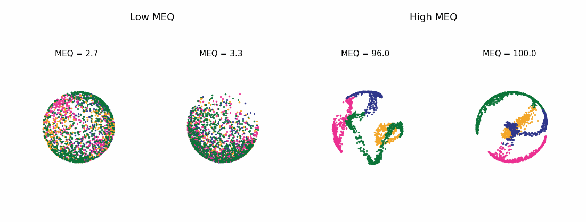

# Analysis pipeline

`analysis_notebook.ipynb` is the complete executable paper-results notebook. Alongside the three-dimensional CEBRA embedding and phase-classification analyses, it reproduces the behavioural associations, representative trajectories and animations, repeated-run silhouette analyses, network perturbation panels, and TAVRNN network-organization figures.

The supplied embedding files are the exact embeddings used to generate the published figures and analyses.

The exact published CEBRA inputs are
`data/no_psilocybin_cebra_embeddings.pkl` and
`data/psilocybin_cebra_embeddings.pkl`. The optional fresh-training workflow instead writes `src/fresh_cebra_outputs/fresh_psilocybin_cebra_embeddings.pkl`; this is a
new stochastic reproduction and does not replace the published inputs.

This release is designed to reproduce the downstream analyses. The notebook validates the participant-level embeddings and supporting metadata before performing the classification, correlation, visualization, and stability analyses reported in the study.

All required analysis inputs are collected in `data/`. Running the notebook produces participant-level classification results, statistical summaries, publication figures, and animations in `outputs/`, keeping the supplied embedding inputs separate from regenerated results. The workflow is intentionally linear so that each result can be traced from data loading and validation through to its corresponding table or figure.

The optional workflows in `src/` provide fresh CEBRA training from the original time series, a fresh 10-fit silhouette analysis, and a fresh checkpointed network-perturbation pipeline. The original saved embeddings remain the exact inputs for downstream figure reproduction used in `analysis_notebook.ipynb`, while the workflows in `src/` document how new embeddings, silhouette estimates, and perturbation estimates can be regenerated from scratch.

## Included analyses

- CEBRA phase embeddings, classification accuracy, and MEQ associations;
- representative participant trajectories, group panels, and animations;
- behavioural-scale correlations and repeated-run silhouette stability;
- network perturbation and network-attribution panels;
- TAVRNN group embeddings and within-network ROI-distance heatmaps; and
- optional fresh CEBRA training, repeated-fit silhouette, and perturbation workflows in `src/`.

## Run

1. Create a Python 3.10 environment and install `requirements.txt`.
2. Keep `data/` next to the notebook.
3. Open `analysis_notebook.ipynb` and run all cells from top to bottom.

Generated tables, PNG figures, and the GIF are written to `outputs/`. 

The raw time-series pickle is included at `data/psicon_time_series.pkl` for the optional `src/` workflows. Because this file exceeds GitHub's normal per-file limit, it is tracked with Git LFS. After cloning, run `git lfs install` followed by `git lfs pull` to retrieve the complete file rather than its small pointer.

> **Note:** The classifier is fitted and evaluated on all time points from each participant/session. Its accuracy is therefore an in-sample measure of phase separability, not cross-validated predictive accuracy. Behavioural scores are used only after classification for participant ordering, display, and correlation.

> **Note:** The CEBRA three-dimensional trajectory visualizations can differ in viewing angle without affecting the underlying embeddings or quantitative analyses.

<h2>Example CEBRA embedding dynamics</h2>

  

